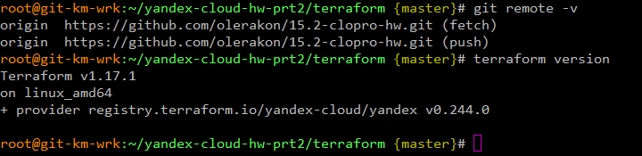
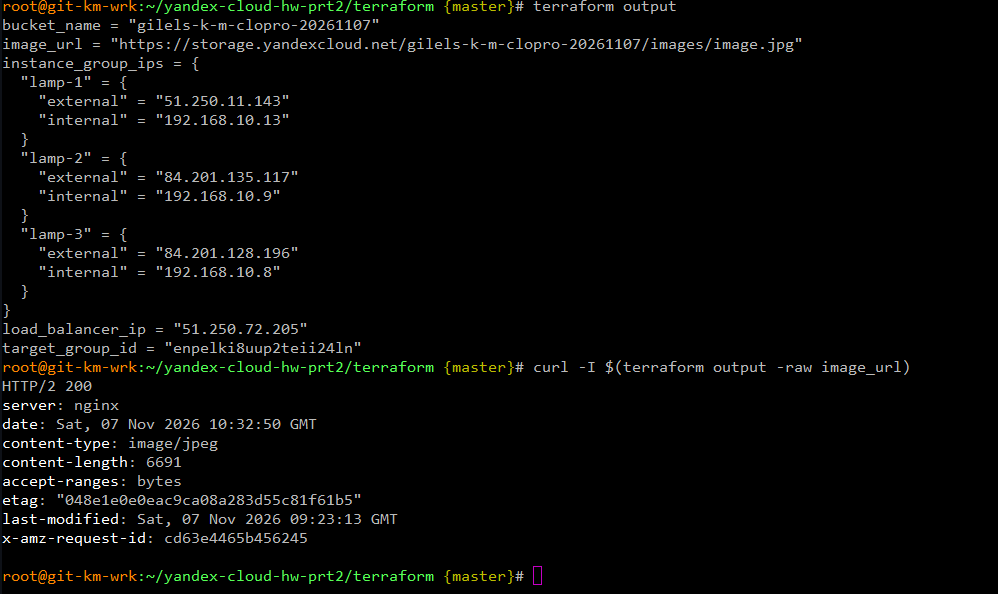
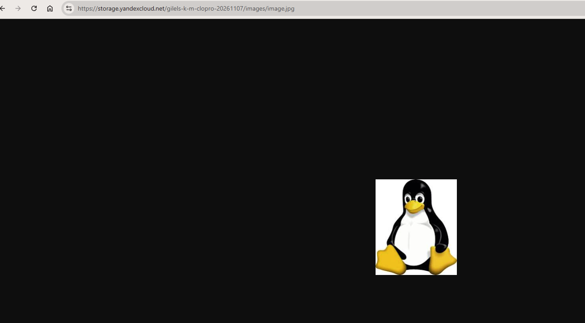

# Домашнее задание к занятию «Вычислительные мощности. Балансировщики нагрузки» - `Гилельс Кирилл`

## Предварительная информация

На VM Ubuntu 24.04 LTS был установлен актуальный Terraform v1.17.1

Яндекс клауд провайдер версии v0.244.0

IP адресс машины 192.168.140.145

Так же был инициализирован гит [репозиторий](https://github.com/olerakon/15.2-clopro-hw) проекта 

Для домашнего задания был создан отдельный каталог: `yandex-cloud-hw-prt2` 

В облаке был создан каталог `clopro-hw`, создан сервисный аккаунт `terraform` с правами `editor`. Дря работы с `object storage` сервисному аккаунту была добавлена роль `storge editor` однако ее оказалось недостаточно. Итоговая конфигурация сервисного аккаунта `editor;storage admin`. Сгенерирован json ключ и ssh ключ под пользователя для VM. Так же были преобразованы и повторно использованы манифесты из первого дз. 

Сводная информация представлена на скриншоте:



------

## Задание 1. Yandex Cloud 

**Что нужно сделать**

1. Создать бакет Object Storage и разместить в нём файл с картинкой:

 - Создать бакет в Object Storage с произвольным именем (например, _имя_студента_дата_).
 - Положить в бакет файл с картинкой.
 - Сделать файл доступным из интернета.
 
2. Создать группу ВМ в public подсети фиксированного размера с шаблоном LAMP и веб-страницей, содержащей ссылку на картинку из бакета:

 - Создать Instance Group с тремя ВМ и шаблоном LAMP. Для LAMP рекомендуется использовать `image_id = fd827b91d99psvq5fjit`.
 - Для создания стартовой веб-страницы рекомендуется использовать раздел `user_data` в [meta_data](https://cloud.yandex.ru/docs/compute/concepts/vm-metadata).
 - Разместить в стартовой веб-странице шаблонной ВМ ссылку на картинку из бакета.
 - Настроить проверку состояния ВМ.
 
3. Подключить группу к сетевому балансировщику:

 - Создать сетевой балансировщик.
 - Проверить работоспособность, удалив одну или несколько ВМ.
4. (дополнительно)* Создать Application Load Balancer с использованием Instance group и проверкой состояния.

---

## Решение

Инфраструктура включает:

- Object Storage bucket с публичной картинкой;
- Instance Group из трёх LAMP VM;
- стартовую страницу с именем VM и картинкой;
- Network Load Balancer с HTTP health check;
- target group, автоматически созданную Instance Group;
- проверку отказоустойчивости при удалении одной VM.

Структура проекта 

```bash
.
├── README.md
├── img/                            # скриншоты
└── terraform/
    ├── providers.tf                # провайдер yandex-cloud/yandex
    ├── variables.tf                # входные переменные (отредактировано и дополнено из ДЗ 15.1)
    ├── terraform.tfvars
    ├── network.tf                  # VPC, подсеть public (отредактировано из ДЗ 15.1)
    ├── storage.tf                  # Object Storage bucket;объект с картинкой; публичный доступ на чтение объекта.
    ├── instance_group.tf           # Instance Group с шаблоном LAMP и health check
    ├── load_balancer.tf            # Network Load Balancer
    ├── outputs.tf
    ├── lamp-user-data.yml          # cloud-init веб-серверов: стартовая страница с картинкой.
    └── files/
        └── image.jpg               # Просто пингвин
```

1. Создал бакет Object Storage и разместил в нём файл с картинкой.

[storage.tf](terraform/storage.tf)

Создаёт:

- Object Storage bucket;
- объект с картинкой;
- публичный доступ на чтение объекта.

Картинка доступна по прямой ссылке:





2. Создал [группу ВМ](terraform/instance_group.tf) в [public](terraform/network.tf) подсети фиксированного размера с [шаблоном LAMP и веб-страницей, содержащей ссылку на картинку из бакета](terraform/lamp-user-data.yml)


[instance_group.tf](terraform/instance_group.tf) `lamp-web-group` создает:

- фиксированный размер: 3 VM;
- LAMP-образ `fd827b91d99psvq5fjit`;
- платформа `standard-v3`;
- 2 vCPU, 2 GB RAM, core fraction 20%;
- HDD-диск 10 GB;
- public subnet;
- публичный IP у каждой VM;
- SSH-ключ через metadata;
- health check HTTP на порту 80 и пути `/`;
- target group для Network Load Balancer.

[network.tf](terraform/network.tf) cоздаёт:

- VPC `netology-vpc`;
- public subnet `public` с CIDR `192.168.10.0/24`.


[instance_group.tf](terraform/instance_group.tf) - Cloud-init конфигурация для каждой VM:

- устанавливает Apache, PHP, PHP-MySQL и модуль Apache PHP;
- создаёт `/var/www/html/index.php`;
- удаляет стандартную страницу Apache `/var/www/html/index.html`;
- включает и перезапускает Apache;
- подставляет имя VM `lamp-{instance.index}` и ссылку на картинку из Object Storage.

[2](img/2.png)

[2.1](img/2.1.png)

[2.2](img/2.2.png)

3. Создал и подключил группу к [сетевому балансировщику](terraform/load_balancer.tf)

Network Load Balancer:

- внешний IPv4 listener на порту 80;
- перенаправление трафика на порт 80 target VM;
- подключение target group, созданной Instance Group;
- HTTP health check на порту 80 и пути `/`.

Так же была проверка отказоустойчивости путем удаления ВМ и проверки непрерывности трафика, автоподьема машины в инстанс.

```bash
LB_IP=$(terraform output -raw load_balancer_ip)
while true; do curl -s -o /dev/null -w "%{http_code}" "http://${LB_IP}/"; sleep 2; done
```

[3](img/3.png)

[3.1](img/3.1.png)

[3.2](img/3.2.png)

[3.3](img/3.3.png)

[3.4](img/3.4.png)

[3.5](img/3.5.png)

[3.6](img/3.6.png)

[3.7](img/3.7.png)

[3.8](img/3.8.png)

[3.9](img/3.9.png)

Итоговый вывод outputs.tf

[4](img/4png)


4. (дополнительно)* Создать Application Load Balancer с использованием Instance group и проверкой состояния.

Yandex Cloud не позволяет одной Instance Group одновременно иметь и load_balancer, и application_load_balancer: API требует выбрать только один из этих блоков. Поэтому для ALB пришлось бы либо пересоздавать Instance Group с ALB-интеграцией, либо создавать отдельную target group и вручную добавлять в неё внутренние IP VM.

Задание не выполнялось.

---
## Задание 2*. AWS (задание со звёздочкой) - НЕ ВЫПОЛНЯЛОСЬ

Пример bootstrap-скрипта:

```
#!/bin/bash
yum install httpd -y
service httpd start
chkconfig httpd on
cd /var/www/html
echo "<html><h1>My cool web-server</h1></html>" > index.html
```
### Правила приёма работы

Домашняя работа оформляется в своём Git репозитории в файле README.md. Выполненное домашнее задание пришлите ссылкой на .md-файл в вашем репозитории.
Файл README.md должен содержать скриншоты вывода необходимых команд, а также скриншоты результатов.
Репозиторий должен содержать тексты манифестов или ссылки на них в файле README.md.